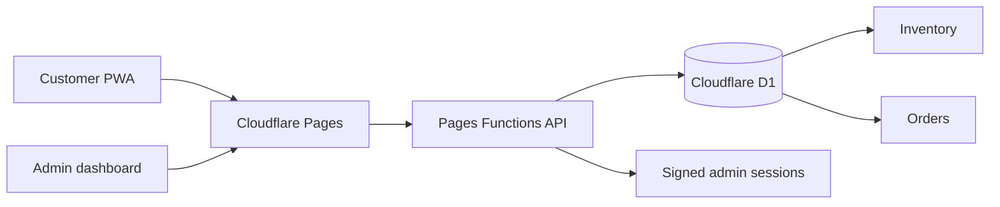

# Utuseb — from home bar to mobile commerce

[Open the live product](https://utuseb.pages.dev)

Utuseb is a home bar and local-delivery business in Namibia. This case study covers the design and engineering of its mobile-first ordering experience, installable web app, operations dashboard and live stock system.

## The brief

The business needed one connected system that customers could order from and Kenny could operate from a phone. The product had to feel premium without feeling corporate, stay usable on a small screen, support cash and eWallet, make telephone contact obvious, and manage real stock behind the storefront.

## What shipped

| Surface | Capability |
| --- | --- |
| Customer shop | Search, 15 category filters, live availability, cart and checkout |
| Product range | 46 seeded items spanning drinks, mixers, tobacco and hookah rentals |
| Payments | Cash on delivery and eWallet to the business number |
| Mobile app | Installable PWA, offline shell, responsive cart and safe-area support |
| Operations | PIN-protected dashboard, order pipeline, revenue summary and stock controls |
| Backend | Pages Functions APIs with Cloudflare D1 persistence |

## Experience strategy

The customer path is deliberately short:

1. Confirm legal age.
2. Browse or search the live catalogue.
3. Add items without leaving the product grid.
4. Enter delivery details.
5. Choose eWallet or cash.
6. Receive an order number while the operator sees the order immediately.

Persistent cart state protects the order if connectivity drops. The call action stays one tap away, while the mobile cart bar keeps the most likely next action within thumb reach.

## Visual direction

The design combines charcoal, warm cream and copper-orange with editorial serif typography. Ambient gradients, interactive light, tactile card motion and soft glass surfaces create energy without sacrificing readability. Reduced-motion preferences are respected, and interactions collapse gracefully on touch devices.

Original category photography was created for beer/cider/cooldrinks, spirits/wine/champagne, and hookah/cigars/tobacco, then compressed into lightweight WebP assets.

## Technical architecture

The storefront is statically rendered and globally cached. Dynamic work is isolated to same-origin functions. D1 is the system of record for products, order lines, fulfilment state and admin login attempts.

## Mobile and security hardening

- Touch targets are at least 44px on mobile controls.
- iOS safe areas and overscroll behaviour are handled.
- Images are lazy-loaded, compressed and available to the offline cache.
- A strict content security policy limits executable and network origins.
- HSTS, `nosniff`, clickjacking and cross-origin opener protections are enabled.
- Admin sessions are HMAC-signed and expire after ten hours.
- Admin login attempts are throttled in D1.
- API responses containing operational data use `no-store`.
- The production repository excludes all local and deployment secrets.

## Operational model

Stock is deducted when an order is accepted. Kenny can move orders through new, confirmed, preparing, out-for-delivery, delivered or cancelled states and adjust each stock count from the same mobile-capable dashboard. Low-stock items are surfaced automatically.

The launch catalogue is intentionally broad and based on popular local categories. Prices, variants, quantities, trading hours and availability remain operator-controlled and should be verified as part of daily operations.

## Outcome

Utuseb now has a focused digital front door at [utuseb.pages.dev](https://utuseb.pages.dev), a practical fulfilment backend, and a foundation that can later add card payments, delivery zones, product variants, promotions and customer accounts without replacing the core system.

---

Case study published by [Freeman Ipumbu](https://github.com/freeman-ipumbu). Production source remains private.
