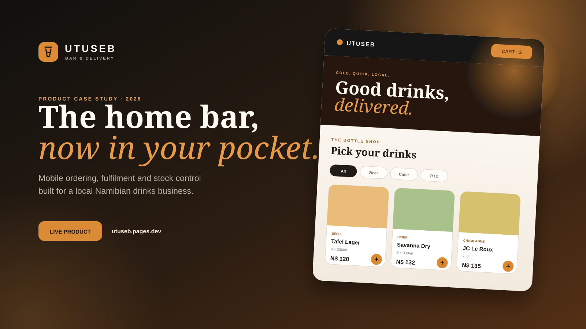
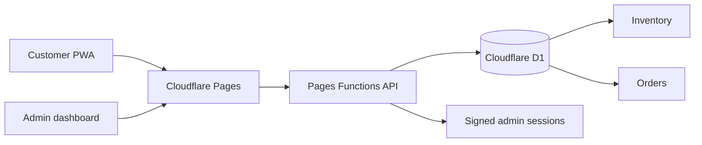

# Utuseb — from private stock to mobile commerce

[Open the live product](https://utuseb.pages.dev)

Utuseb is a private drinks-delivery operation in Namibia, not a public walk-in bar. Customers can choose local delivery or free pickup by prior arrangement. This case study covers the design and engineering of its mobile-first ordering experience, installable web app, operations dashboard and live stock system.

## The brief

The business needed one connected system that customers could order from and Kenny could operate from a phone. The product had to feel premium without feeling corporate, stay usable on a small screen, support cash and eWallet, make telephone contact obvious, and manage real stock behind the storefront.

## What shipped

| Surface | Capability |
| --- | --- |
| Customer shop | Delivery or arranged pickup, search, 15 category filters, live availability, cart and checkout |
| Product range | 46 product-specific items spanning drinks, mixers, tobacco and hookah rentals |
| Payments | Cash on delivery and eWallet to the business number |
| Mobile app | Installable PWA, offline shell, responsive cart and safe-area support |
| Operations | PIN-protected all-orders ledger, fulfilment pipeline, sales/stock reporting and stock controls |
| Backend | Pages Functions APIs with Cloudflare D1 persistence |

## Experience strategy

The customer path is deliberately short:

1. Confirm legal age.
2. Browse or search the live catalogue.
3. Add items without leaving the product grid.
4. Choose delivery or pickup by arrangement and enter the required details.
5. Choose eWallet or cash.
6. Receive an order number while the operator sees the order immediately.

Persistent cart state protects the order if connectivity drops. The call action stays one tap away, while the mobile cart bar keeps the most likely next action within thumb reach.

## Visual direction

The design combines charcoal, warm cream and copper-orange with editorial serif typography. Ambient gradients, interactive light, tactile card motion and soft glass surfaces create energy without sacrificing readability. Reduced-motion preferences are respected, and expensive decorative effects collapse gracefully on touch devices.

Every catalogue line now has its own recognisable product packshot: Tafel, Windhoek, Savanna, Hunters, Heineken, Castle Lite, Corona, Brutal Fruit, Jameson, Johnnie Walker, Jack Daniel's, JC Le Roux, Moët, Fanta, Sprite and the rest no longer reuse generic category art. The 46 supplier/manufacturer packshots were normalized into 512px WebP files; the complete source register is maintained in the private production repository so each asset can be audited or replaced with Kenny's own photography.

## Technical architecture

The storefront is statically rendered and globally cached. Dynamic work is isolated to same-origin functions. D1 is the system of record for products, order lines, fulfilment state and admin login attempts.

## Mobile and security hardening

- Touch targets are at least 44px on mobile controls.
- iOS safe areas and overscroll behaviour are handled.
- Above-the-fold packshots load with priority; the rest are lazy-loaded, compressed and cached as used.
- Off-screen catalogue cards use browser rendering containment to cut mobile paint work.
- Large blur layers, pointer lighting and continuous decorative animation are disabled on touch devices.
- A strict content security policy limits executable and network origins.
- HSTS, `nosniff`, clickjacking and cross-origin opener protections are enabled.
- Admin sessions are HMAC-signed and expire after ten hours.
- Admin login attempts are throttled in D1.
- Checkout accepts JSON only, caps request size and quantity, merges duplicate lines and throttles repeated order attempts.
- API responses containing operational data use `no-store`.
- The production repository excludes all local and deployment secrets.

## Operational model

Stock is deducted when an order is accepted. Kenny can move delivery and pickup orders through the same clear fulfilment queue and adjust each stock count from the mobile-capable dashboard. Low-stock items are surfaced automatically.

Pickup is always free, with the time and private collection point confirmed directly by Kenny. The customer's first delivery is free; later deliveries are free when the item subtotal reaches N$ 200 and N$ 50 below that threshold. The server calculates the fee from live prices and order history, so the checkout total cannot be manipulated in the browser.

Checkout fields are constrained in the interface and revalidated by the API. Customer numbers must be exactly 10 digits in local Namibian format, and pickup orders require an explicit requested date and time within the next 30 days. The requested slot appears in Kenny's order queue but remains subject to direct confirmation.

The control room includes a searchable, status-filtered and paginated order ledger; pickup-aware “ready for pickup” handling; range-based revenue and order KPIs; daily sales charts; cash/eWallet mix; best sellers; inventory valuation; low/out-of-stock watchlists; and formula-injection-safe CSV exports for sales and stock reporting.

The launch catalogue is intentionally broad and based on popular local categories. Prices, variants, quantities, trading hours and availability remain operator-controlled and should be verified as part of daily operations.

## Outcome

Utuseb now has a focused digital front door at [utuseb.pages.dev](https://utuseb.pages.dev), a practical fulfilment backend, and a foundation that can later add card payments, delivery zones, product variants, promotions and customer accounts without replacing the core system.

---

Case study published by [Freeman Ipumbu](https://github.com/freeman-ipumbu). Production source remains private.
